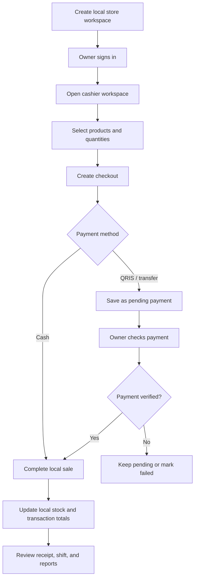

# POS TERPADU
### Point of Sale for Small Shops & Micro Businesses

**A responsive browser-based POS prototype with inventory, shifts, and operational reporting.**

---

## Overview

POS Terpadu is a web/PWA project designed around common point-of-sale workflows for small retail businesses. The current MVP runs locally in the browser and stores its operational data in localStorage.

A Supabase PostgreSQL schema, row-level security policies, and RPC drafts are included as a future backend foundation, but the current frontend is **not connected to Supabase**.

> **Important — Demo mode only**  
> Do not use the current local-storage version as a production cashier system or to store sensitive financial, employee, or customer information. Browser storage can be cleared, edited, or accessed by the user.

## Features in the local MVP

- **Workspace setup** — create a shop workspace and initial owner profile.
- **Local authentication demo** — owner and cashier access with PIN derivation using PBKDF2 and browser Web Crypto.
- **Dashboard** — revenue, gross-profit estimates, expenses, low-stock alerts, weekly trends, and recent transactions.
- **Cashier / POS** — search products by name or SKU, filter categories, manage cart quantities, and check out using cash, QRIS, or bank-transfer labels.
- **Pending payments** — non-cash payments can remain pending until owner verification; pending transactions do not count as revenue or reduce stock.
- **Product and category management** — create, edit, archive, and maintain prices, cost values, minimum stock, and SKU data.
- **Stock operations** — record stock-in and stock-out adjustments with reasons.
- **Transaction history** — invoice details, receipt printing, CSV export, and void operations with a reason.
- **Shift management** — opening cash, expected closing cash, counted cash, and variance.
- **Expense records** — cash and non-cash expenses with editing and void history.
- **Reports** — daily, seven-day, and thirty-day performance summaries.
- **Employee management** — local cashier profiles and PIN reset.
- **Store settings** — theme options, JSON backup export, and PWA shell caching.

All of these workflows operate against local browser data in the current MVP.

## Cashier and payment flow

All states in the current MVP are stored in the browser. Supabase is a schema and integration draft, not the active transaction backend.

## Technology

- HTML5, CSS3, and Vanilla JavaScript ES modules.
- Node.js built-in tooling for the local development server.
- Service Worker and Web App Manifest for PWA shell support.
- Web Crypto API for local PIN derivation.
- localStorage for demo persistence.
- Supabase SQL migration draft (not connected to the running frontend).

The application does not require third-party npm runtime dependencies.

## Requirements

- Modern browser with Web Crypto API and Service Worker support.
- Node.js 18+ recommended for the included development server, or Python 3 for an alternate local server.
- HTTPS or localhost for browser APIs that require a secure context.

## Run locally

### Node.js

    git clone https://github.com/gusti111/POS-Terpadu-Warung-Usaha-Kecil.git
    cd POS-Terpadu-Warung-Usaha-Kecil
    npm run dev

Open http://localhost:4173.

### Python alternative

    python -m http.server 4173

Open http://localhost:4173.

Do not open the page through file://; use localhost or HTTPS so the required browser APIs can operate correctly.

## First-time demo setup

1. Create the local workspace and owner account from the initial setup screen.
2. Optionally load the sample catalog and simulated transactions.
3. Sign in using the owner credentials created in the browser.
4. Add a cashier profile from the employee area to explore the cashier flow.
5. Switch between owner and cashier accounts to inspect the role-specific interface.

Sample records are fictional and are stored locally. Use the application's reset action to clear the demo workspace.

## Business rules in demo mode

- Only completed and paid sales contribute to revenue.
- Pending QRIS or bank-transfer transactions do not add revenue or reduce stock.
- The sale records snapshot the item name, SKU, selling price, and cost at completion.
- Stock cannot be reduced below zero through the domain rules.
- Completed sales are corrected through a void action with a reason rather than direct editing.
- Expected cash is calculated from opening cash, cash sales, cash expenses, and cash refunds.
- A local account can have only one active shift at a time.

These rules are implemented in the local demo domain and must be enforced again by a trusted backend before multi-user deployment.

## Supabase backend draft

The file supabase/migrations/001_pos_core.sql contains a PostgreSQL schema and draft authorization policies and RPC functions for operations such as owner setup, checkout, payment verification, sale voiding, stock adjustment, and shift management.

The frontend does not currently use Supabase Auth, PostgREST, or those RPC functions. The migration is a starting point for backend integration, not evidence of a live database.

Before connecting a production backend:

1. Review the migration on a new development project.
2. Test Row Level Security with separate owner and cashier identities and separate stores.
3. Move sensitive operations into trusted RPCs or server-side functions.
4. Test transaction rollback, concurrent stock updates, idempotency, and post-close void policy.
5. Replace the local browser store with a Supabase-backed repository.
6. Never expose the Supabase service-role key in browser code.

See supabase/README.md.

## Verification

Run the Node.js test suite:

    npm test

Tests cover selected domain and store behaviors. They do not validate Supabase, RLS, browser integration, physical receipt printers, or cross-device operation.

Use docs/QA_CHECKLIST.md for the manual validation plan.

## Documentation

- docs/ARCHITECTURE_AND_FLOWS.md — architecture and key user flows.
- docs/IMPLEMENTATION_NOTES.md — implementation decisions and known details.
- docs/QA_CHECKLIST.md — manual QA scenarios.
- docs/RELEASE_NOTES.md — project change log.
- supabase/README.md — backend migration and RPC notes.

## Project status

Local Demo MVP. The browser application provides a broad local POS experience, while persistent multi-user data, trusted authentication, backend transactions, and production-grade access control remain future integration work.

## Repository

[github.com/gusti111/POS-Terpadu-Warung-Usaha-Kecil](https://github.com/gusti111/POS-Terpadu-Warung-Usaha-Kecil)