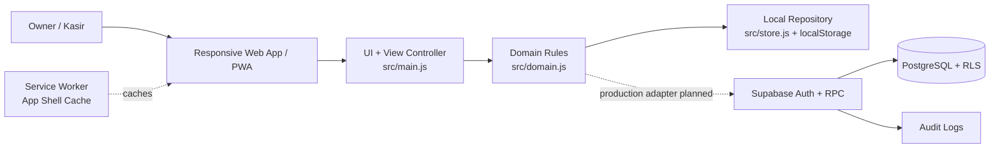
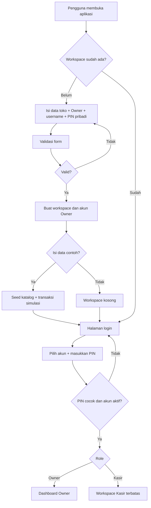
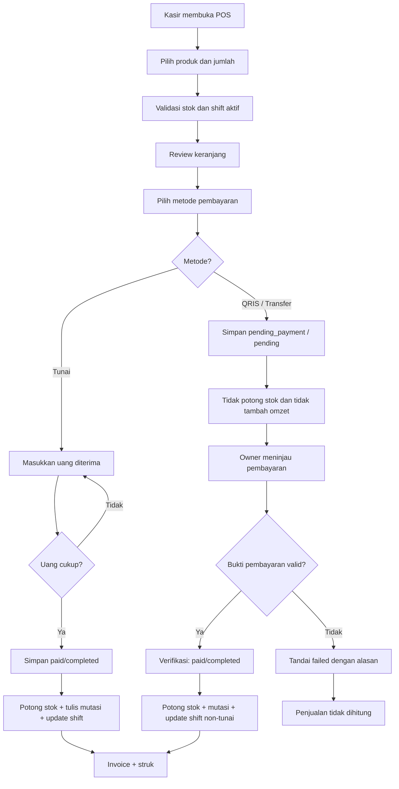
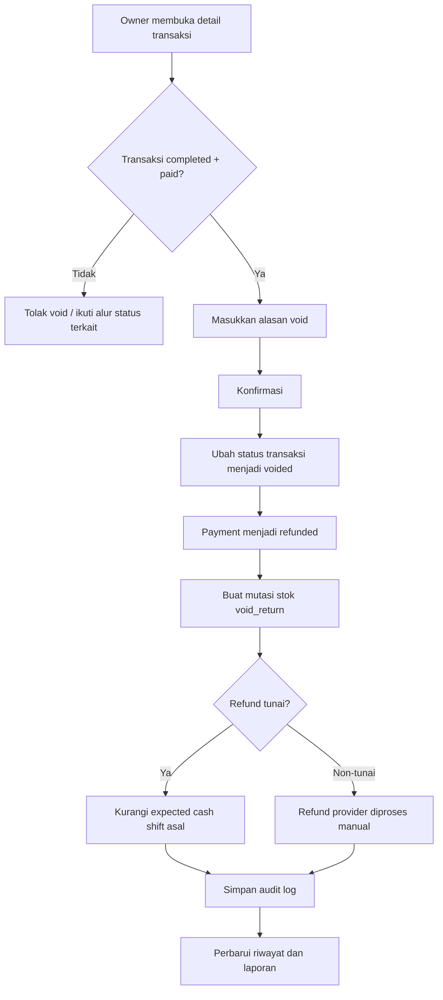
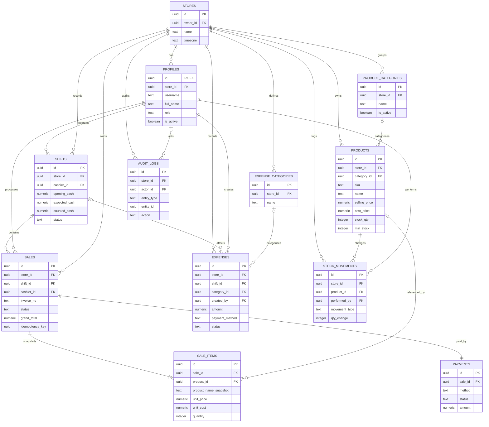

# Arsitektur, ERD, dan Alur Pengguna — POS Terpadu

Dokumen ini merangkum rancangan teknis MVP. Diagram backend merupakan rancangan target Supabase dari `supabase/migrations/001_pos_core.sql`; aplikasi yang ada di ZIP saat ini menjalankan repository lokal browser, bukan koneksi Supabase.

## 1. Konteks arsitektur

**Implementasi sekarang:** UI → domain → localStorage. Panah putus-putus ke Supabase menunjukkan target integrasi, bukan fitur aktif.

## 2. Alur setup dan autentikasi lokal

PIN lokal diubah menjadi verifier PBKDF2 dengan salt unik menggunakan Web Crypto. Mekanisme ini hanya untuk demonstrasi satu browser; untuk produksi gunakan Supabase Auth dan RLS.

## 3. Alur checkout dan pembayaran

Invariant:
- Hanya status penjualan `completed` dengan payment `paid` yang masuk omzet.
- Pembayaran pending tidak memotong stok dan tidak mengubah omzet.
- Request berulang menggunakan idempotency key pada domain model.
- Pada backend target, seluruh proses checkout harus berada dalam satu transaksi PostgreSQL/RPC.

## 4. Alur void penjualan

Void adalah tindakan koreksi, bukan delete. Catatan transaksi dan mutasi tetap disimpan.

## 5. ERD target PostgreSQL / Supabase

## 6. Matriks peran ringkas

| Modul | Owner | Kasir |
|---|---|---|
| Dashboard & laporan | Semua data toko | Tidak tersedia |
| POS & checkout | Ya | Ya |
| Produk, kategori, persediaan | CRUD/arsip | Tidak tersedia |
| Transaksi | Semua transaksi, verifikasi, void | Transaksi sendiri |
| Shift | Semua shift | Shift sendiri |
| Pengeluaran | Semua, termasuk void | Milik sendiri bila diizinkan Owner |
| Karyawan & pengaturan | CRUD/pengelolaan | Tidak tersedia |

> Matriks ini menggambarkan UX/demo lokal. Backend production wajib menegakkan permission yang sama pada RLS dan RPC.
